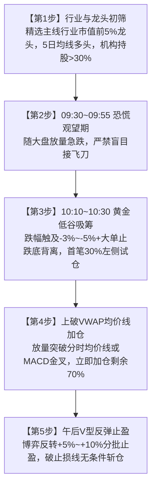

# 🎯 Daily Low-Buy Dragon | A股龙头日内最低点低吸买点战法

[](https://www.python.org/)
[](LICENSE)
[](#)

> **“买在无人问津处，卖在人声鼎沸时。日内最低点不是盲目猜底，而是恐慌出清、大单承接与均线共振的必然产物。”**
>
> 核心法门：**09:30恐慌观望 -> 10:10低谷大单试仓30% -> 上破VWAP加仓70% -> 午后V型止盈 -> 0.5%~1%刚性止损**。

---

## 📖 战法背景与核心逻辑

在 A 股短线与波段交易中，追高打板一旦遭遇指数冲高回落，极易日内吃下 -5%~-10% 的巨额回撤。

**Daily Low-Buy Dragon** 专注于在同一交易日的**日内最低点/谷底区间**精准低吸行业主线龙头：
1. **为什么选龙头？** 只有具备机构持股、行业地位与巨量流动性的核心龙头，才具备在恐慌盘宣泄后被大单托底拉出 V 型反转的能力；
2. **为什么买在日内低点？** 股票的日内最低点多出现在早盘恐慌盘集中涌出的 10:10~10:30，结合分时底背离与 VWAP（分时成交均价线）技术确认，建立极具优势的“日内安全垫”。

---

## 🧭 日内择时工作流



---

## 📊 日内分时核心节点

| 时间区间 | 盘口与量价特征 | 战术应对与实战动作 |
| :--- | :--- | :--- |
| **09:30 ~ 09:55（开盘恐慌期）** | 大盘急跌，龙头随指数放量下探，跌破5日线 | **绝对观望**，等待恐慌盘与不坚定筹码彻底出清 |
| **10:10 ~ 10:30（黄金低谷期）** | 触及日内最大跌幅（-2.5%~-5%），盘口出现数万手大买单托底，分时底背离 | **首笔 30% 试仓买入**，止损设在买入价下方 0.5%~1% |
| **转强确认点（上破 VWAP）** | 分时放量上破白色均价线（VWAP），MACD金叉 | **立即加仓 70%**，锁定全天低成本安全垫 |
| **13:00 ~ 15:00（午后持仓期）** | 资金回流走出 V 型反转，由绿翻红 | 触及 +5%~+10% 目标位分批止盈 |

---

## 📂 项目结构

```
daily-low-buy-dragon/
├── main.py                     # 主运行入口
├── requirements.txt            # Python 依赖清单
├── LICENSE                     # MIT 开源许可证
├── .gitignore                  # Git 忽略配置
├── SKILL.md                    # Antigravity / Agent Skill 技能规范
├── docs/
│   └── methodology.md          # 完整战法理论、分时战术与寒武纪复盘手册
├── scripts/
│   └── scan_daily_low_buy.py   # 日内分时最低点与VWAP偏离监控引擎
└── reports/                    # 监控分析报告输出目录 (.gitkeep)
```

---

## 🚀 快速上手

### 1. 环境准备
确保已安装 Python 3.8+，克隆本仓库并安装依赖：

```bash
git clone https://github.com/shuiseliuli/daily-low-buy-dragon.git
cd daily-low-buy-dragon
pip install -r requirements.txt
```

### 2. 运行监控器

```bash
python main.py
# 或
python scripts/scan_daily_low_buy.py
```

### 3. 输出演示

监控器将实时拉取核心主线龙头的即时行情切片，测算当前价相对 VWAP 的偏离度、日内低点反弹幅度与最大回撤深度，并在控制台输出信号标签与建仓建议：

```text
=============================================================================================================
  🎯 A股龙头日内最低点低吸买点监控器 (Daily Low-Buy Dragon Scanner) 🎯
  当前时间: 2026-10-28 10:25:00
  核心法门: 09:30恐慌观望 -> 10:10低谷大单试仓30% -> 上破VWAP加仓70% -> 午后V型止盈 -> 0.5%刚性止损
=============================================================================================================
代码     名称     行业         现价    涨跌%   VWAP均价  低点反弹% 信号标签               操作建议
-------------------------------------------------------------------------------------------------------------
688777   中控技术 工业AI/机器人 45.20   -3.15   45.58     0.45      🔥 黄金低吸买点 (30%仓) 🎯 黄金低吸区！首笔30%试探介入，止损设下方0.8%
688256   寒武纪   算力芯片     78.20    1.25   77.80     2.15      🚀 VWAP突破加仓 (70%仓) ⚡ 转强确认！立即执行第二笔70%加仓，博弈午后V型
...
=============================================================================================================
✅ 日内低吸监控报告已保存至: reports/daily_low_buy_20261028_102500.json
```

---

## 🛡️ 纪律风控与铁律

1. **刚性止损红线**：买入后若未能如期止跌，放量跌破买入价下方 **0.5%~1.0%**（或有效击穿 5 日均线），必须无条件止损离场！
2. **严禁早盘冲高追涨**：若早盘直接单边拉升则主动放弃，绝不在盘中冲动追高。
3. **严格仓位管理**：单票短线仓位控制在 20%~30%，严禁全仓单吊。

---

## ⚠️ 免责声明

本仓库所有量化规则、指标计算与代码仅供技术与策略研究参考，不构成任何投资建议。股市有风险，入市需谨慎！

---

## 📄 开源许可证

本项目基于 [MIT License](LICENSE) 开源。
