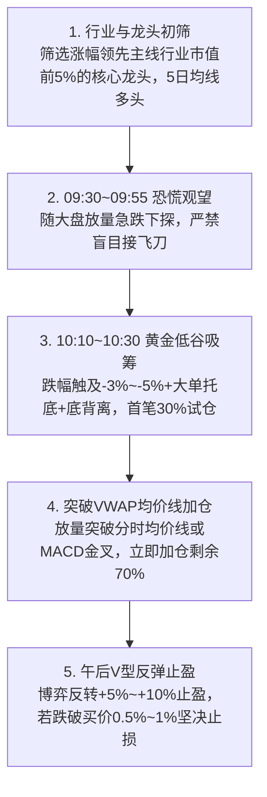

# A股龙头日内最低点低吸买点战法 (Daily Low-Buy Dragon)

本技能将**“早盘恐慌观望、10:10~10:30日内低谷大单试仓30%、上破VWAP加仓70%、午后V型反转止盈、刚性止损”**的日内精准择时方法论，沉淀为标准化的自动化量化监控工具。

---

## 核心战法执行逻辑



---

## 快速使用

在终端中执行：

```bash
python main.py
# 或
python scripts/scan_daily_low_buy.py
```

### 核心研判原则
- **09:30~09:55**：大盘放量急跌，空头卖压释放期，**绝对观望，禁止入场**；
- **10:10~10:30**：恐慌盘衰竭，触及最大跌幅，大单买盘出现，**首笔 30% 左侧试仓**；
- **5~10分钟后**：放量突破 VWAP 分时成交均线，**立即加仓 70%**；
- **纪律止损**：跌破买入价下方 0.5%~1% 或放量击穿 5 日均线立即止损认错。

---

## 详细手册参考
- 完整理论体系与实战心法详见：[A股龙头日内最低点低吸战法核心手册](./docs/methodology.md)
