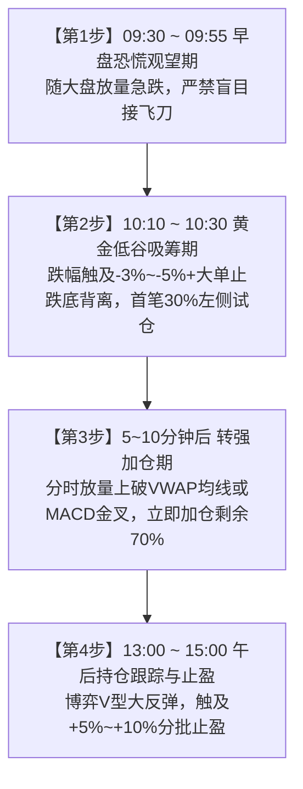

# A股龙头日内最低点低吸战法核心手册

> **核心目标**：在同一交易日的日内最低点/谷底区间精准介入行业主线龙头，捕捉日内反弹安全垫与波段超额利润。

---

## 一、 方法论底层逻辑

在短线与波段交易中，追高买入（追涨打板）一旦遭遇指数冲高回落或分歧跳水，极易日内吃下 -5%~-10% 的巨幅大面。

本战法反其道而行之：**“借市场恐慌买龙头，借日内谷底做低吸”**。
- **为什么选龙头？** 只有行业市值最大、机构持股高、流动性充沛的核心龙头，才具备在恐慌杀跌后被主力大单强力承接并走出 V 型反转的能力；
- **为什么能买在日内最低点？** 绝大多数股票的日内最低点不是随机出现的，而是伴随着散户恐慌杀跌盘涌出（上午 10:10~10:30）与主力大单托底的“量价时空”共振。

---

## 二、 前置筛选与准备工作

| 筛选步骤 | 筛选维度 | 严格量化标准 | 核心博弈目的 |
| :--- | :--- | :--- | :--- |
| **① 行业筛选** | 行业板块指数 | 当日所属行业指数或板块涨幅排名前列（或处于主升浪趋势） | 确保股票具备主线板块协同动能，杜绝冷门孤儿票 |
| **② 龙头候选** | 市值与成交量 | 细分行业内市值排名前 5%，日均成交量充沛（>500万股或成交额>5亿），机构持股 >30% | 保证流动性充足，有机构底仓承接，拒绝流动性陷阱 |
| **③ 技术过滤** | 均线与指标 | 1. 处于 5 日均线多头排列或回踩 5 日线支撑； 2. 关注分时 VWAP（分时成交均价线）； 3. MACD 出现 5 分钟/15 分钟级别底背离； 4. OBV 能量潮底仓未出。 | 确保技术形态处于上升通道中，回调是良性洗盘而非破位出货 |

---

## 三、 日内分时最低点捕捉四步曲

### 1. 09:30 ~ 09:55（开盘恐慌期·绝对观望）
- **盘面特征**：受夜盘外围波动或隔夜情绪影响，大盘低开或开盘冲高后快速放量跳水，龙头股票随大盘急跌下探，甚至瞬间击穿 5 日均线。
- **操作原则**：**绝对克制，保持空仓观望**！绝不可在 9:40 之前盲目抄底，必须等待早盘不坚定的浮动割肉盘彻底出清，等待卖压衰竭。

### 2. 10:10 ~ 10:30（黄金低谷期·首笔 30% 试仓）
- **盘面特征**：
  1. 股价跌至当日最大跌幅区间（通常在 -2.5% ~ -5.0% 之间），靠近前期平台支撑或 5 日线关键位；
  2. 买一至买五盘口突然出现**连续数万手的大买单挂单护盘**；
  3. 分时呈现典型**“底背离”**：价格创出日内新低，但分时成交量不再放大，反而出现缩量钝化。
- **操作原则**：**左侧果断低吸**！在最低价附近执行**第一笔 30% 头寸试探性买入**，同时在买入价下方 0.5%~1% 设置刚性防守止损线。

### 3. 转强确认点（上破 VWAP 均价线·加仓 70%）
- **盘面特征**：买入后 5~10 分钟内，主力大单持续回补，分时线快速放量拉升，**一举上破白色的分时均线（VWAP）**，MACD 形成金叉发散。
- **操作原则**：**右侧转强确认**！在上破 VWAP 或回踩均线不破的瞬间，**立即加仓剩余 70% 仓位**，迅速将全日成本锁定在日内极低区间，建立起坚实的“日内安全垫”。

### 4. 13:00 ~ 15:00（午后跟踪与止盈管理）
- **盘面特征**：午后行业资金回流，带动脉冲式拉升，走出经典“V 型反转”，收盘价往往由绿翻红上涨 +2% ~ +5% 以上。
- **操作原则**：日内浮盈丰厚，可根据次日预期从容持股格局；若触及 +5%~+10% 目标位或尾盘遇阻，可逢高了结部分利润。

---

## 四、 实战经典复盘案例（寒武纪 688777）

- **交易日期**：2026-10-12
- **标的**：寒武纪（688777，算力芯片绝对龙头）
- **早盘动态**：开盘价 78.90 元（低开 -1.4%），随后随科创板震荡下挫；
- **最低点捕捉**：10:10 触及日内最低价 77.18 元（日内跌幅 -3.5%），精准踩在 5 日均线 77.30 元上方；盘口连续出现多笔 5000 手以上主动买单，MACD 15 分钟底背离成立；
- **执行过程**：
  - 10:15 在 77.22 元买入首批 30% 试仓；
  - 10:25 股价带量上破 VWAP 均价线 77.80 元，立即在 77.85 元追击加仓剩余 70%；
- **收盘结果**：收盘强势收报 79.30 元（全天由跌 -3.5% 转为大涨 +2.2%）；
- **收益成效**：日内安全垫达到 **+2.7%**，次日开盘从容享受高开溢价。

---

## 五、 铁血风控与纪律红线

1. **刚性止损位**：首笔 30% 买入后，若股价未能在 10 分钟内企稳，反而放量击穿买入价下方 **0.5%~1.0%**（或有效跌破 5 日线支撑），必须无条件止损认错。
2. **严禁在早盘冲高时追涨**：所有操作均在恐慌缩量低谷执行，若早盘直接单边拉升则放弃该策略，切勿盘中冲动追高。
3. **仓位纪律**：单一龙头日内配置不超过总资金的 20%~30%，严禁全仓单吊。
